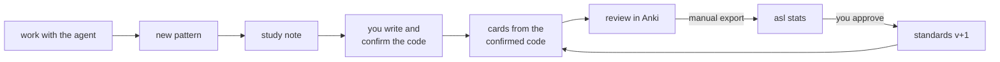

# agentic-studying-loop

Learn the code you write. While you work on a real project with an AI coding agent (Claude Code),
what you learn becomes **study notes** in your vault and **Anki cards** that look like your repo,
and the card rules get **tuned on your own review data**.



Grown out of [rust-lang-kata](https://github.com/yungselm/rust-lang-kata), whose card rules were
re-derived from 6.5k of the author's reviews (*typed characters, not lines, predict failure*;
*every leech was a code card asking for a whole program*).

## What's in the box

| | |
|---|---|
| **`asl` CLI** | YAML → `.apkg` (code cards with in-card editor + line diff, concept cards, timeline cards). `fix` does the bookkeeping, `lint`/`check` do the verifying, `stats` reads your reviews. |
| **Packs** | Per language: highlighting, a checker that compiles/lints/tests every card, a standards addendum. **Rust** (clippy + cargo test), **Python** (ruff + pytest). |
| **Standards** | Data-backed card rules (`standards/core.md`), copied into your vault where they evolve. |
| **Modes** | How much the agent teaches: `teacher`, `mentor`, `coworker`, `on-demand`. |
| **Skills** | `study-note`, `write-cards`, `check-cards`, `refresh-standards`. Plugin or plain files. |
| **Examples** | `example-vault/` (notes, card home, project deck) + `examples/tasklog/` (its project). |

## Quickstart

```bash
git clone https://github.com/yungselm/agentic-studying-loop && cd agentic-studying-loop
uv venv && uv pip install -e ".[python]"      # or: python -m venv .venv && pip install -e ".[python]"
asl build examples/python-core "example-vault/Studying/Anki cards/tasklog"   # try it in Anki

# connect your project: card home in the vault, a deck folder, a block in CLAUDE.md
asl init ~/code/myproject --home "~/Vault/Studying/Anki cards" \
         --pack python --prefix myp --mode mentor --notes "~/Vault/Studying/MyProject"
```

Give the agent the skills, as a plugin
(`/plugin marketplace add yungselm/agentic-studying-loop`, then
`/plugin install agentic-studying-loop@agentic-studying-loop`) or as files (`asl install-skills`).

Day to day the agent runs these; you can too:

```bash
asl fix   <deck>    # add ids, std versions, Overview.md rows
asl lint  <deck>    # sizes, self-containment, context frame, headers, verbatim excerpts, drift
asl check <deck>    # compile / lint / run each card's tests
asl build <deck> -o myproject.apkg   # import with "Update notetypes" + "Import any deck presets"
```

## Modes (`asl mode <name> <project>`)

| mode | code | notes | cards |
|---|---|---|---|
| `teacher` | **you**; the agent never edits source | first | automatic, from confirmed code |
| `mentor` | you drive; agent helps on request | offered | proposed at session end |
| `coworker` | the agent | on request | one-line flags; on request |
| `on-demand` | the agent | on request | on request |

## Your card home

```
Studying/Anki cards/
├── studyloop.yaml       limits, refresh thresholds, standards_version
├── standards/           core.md, <pack>.md, preferences.md (yours, newest last, they win)
├── evidence/            asl stats reports
└── myproject/           deck.yaml, myproject.yaml (checked), myproject_ext.yaml (verbatim),
                         profile.md (file roles), Overview.md (card index)
```

## Tuning on your data

Whenever you like: Anki → File → Export → *Anki Deck Package* with *Include scheduling
information*, then ask the agent to *refresh my standards*, or run
`asl stats export.apkg --home "<card home>"`. The report says if a refresh is due (default: half
the deck mature, then every further 25%), shows fail rates by card size, leeches, hard decks, and
whether the last rule change helped. The agent proposes edits; you approve.

## Docs

[Card format](docs/card-format.md) · [Writing a pack](docs/writing-a-pack.md) ·
[Migrating from rust-lang-kata](docs/migrating-from-rust-lang-kata.md) · [Roadmap](docs/roadmap.md)

v0.1. Starter standards rest on one learner's data; packs, card types and anonymised `asl stats`
tables are welcome (see CONTRIBUTING.md). MIT; vendors CodeMirror 5 (MIT).
