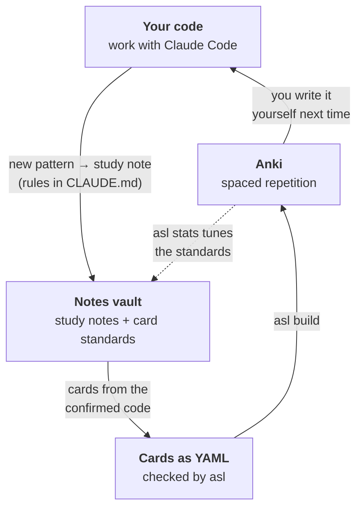
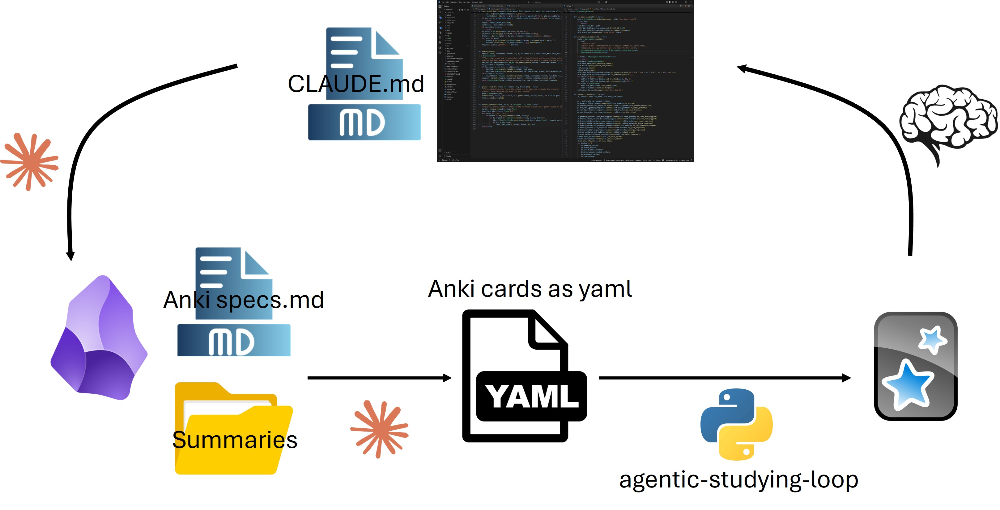

<p align="center">
  <a href="https://github.com/yungselm/agentic-studying-loop">
    
  </a>
</p>

# agentic-studying-loop

Learn the code you write. While you work on a real project with an AI coding agent (Claude Code),
what you learn becomes **study notes** in your notes vault and **Anki cards** that look like your
repo. Then the card rules get **tuned on your own review data**.

**What you need** (free, apart from a Claude plan and the optional iPhone app; click to download):

[](https://apps.ankiweb.net/)
[](https://obsidian.md/download)
[](https://claude.com/claude-code)
[](https://docs.astral.sh/uv/getting-started/installation/)

- **[Anki](https://apps.ankiweb.net/)**: the spaced-repetition app that shows you the cards.
  Free on desktop and Android (AnkiDroid); the iPhone app is paid. AnkiWeb syncs them.
- **[Obsidian](https://obsidian.md/download)**: where your study notes and card files live. Optional:
  any folder of markdown files works, Obsidian just makes the notes pleasant to read and link.
- **[Claude Code](https://claude.com/claude-code)**: the coding agent that writes notes and cards.
- **[uv](https://docs.astral.sh/uv/getting-started/installation/)** (or pipx) to install the `asl`
  tool; for Rust cards also a [Rust toolchain](https://rustup.rs/).



Grown out of [rust-lang-kata](https://github.com/yungselm/rust-lang-kata), whose card rules were
re-derived from 6.5k of my personal reviews (*typed characters, not lines, predict failure*;
*every leech was a code card asking for a whole program*).

## How it fits together

You don't clone this repo to use it. There are three places, and you set each up once:

| | What | Where it lives | Set up with |
|---|---|---|---|
| **1. The tool** | the `asl` command, language packs, default standards, modes, templates | installed like any CLI | `uv tool install …` |
| **2. The agent's skills** | `study-note`, `write-cards`, `check-cards`, `refresh-standards` | Claude Code | `/plugin install …` or `asl install-skills` |
| **3. Your data** | your standards, notes and cards | your notes vault (e.g. Obsidian), plus one block in each project's `CLAUDE.md` | `asl init` |

```
~/Vault/Studying/                     <- your notes vault (3)
├── test-rs/                         <- study notes for the project (the agent writes them)
└── Anki cards/                       <- the "card home"
    ├── studyloop.yaml                   limits, refresh thresholds, standards version
    ├── standards/                       core.md, rust.md, preferences.md: YOUR rules, they evolve
    ├── evidence/                        reports from `asl stats`
    └── test_rs/                        one deck folder per project
        ├── deck.yaml                    deck name, pack, id prefix, repo path
        ├── test_rs.yaml                cards checked by `asl check` (std + stubs)
        ├── test_rs_ext.yaml            cards with third-party code (verbatim, not compiled)
        ├── profile.md                   file roles for the cards' location headers
        └── Overview.md                  card index

~/code/test-rs/                      <- your project: unchanged, except
└── CLAUDE.md                            a study-loop block (mode + the paths above)
```

## 1. Install the tool

```bash
uv tool install git+https://github.com/yungselm/agentic-studying-loop
# or: pipx install git+https://github.com/yungselm/agentic-studying-loop
asl packs                       # shows the bundled packs: python, rust
```

Update later with `uv tool upgrade agentic-studying-loop`. The Python pack works out of the box
(ruff and pytest come with the tool). The Rust pack needs a Rust toolchain
(`rustup component add clippy`).

## 2. Give the agent the skills

In Claude Code, either install the plugin:

```
/plugin marketplace add yungselm/agentic-studying-loop
/plugin install agentic-studying-loop@agentic-studying-loop
```

or copy the skills into `~/.claude/skills` with `asl install-skills`.

## 3. Connect a project

```bash
asl init ~/code/test-rs \
    --home  "~/Vault/Studying/Anki cards" \
    --notes "~/Vault/Studying/test-rs" \
    --pack rust --prefix snk --mode mentor
```

On Windows, the same command with `C:\...` paths works in PowerShell (use a backtick or one line
instead of `\` line breaks). This creates the card home (only the first time), the deck folder,
and the study-loop block in the project's `CLAUDE.md`. Fill in the file roles in `profile.md`
when the first cards need them; the agent can do that too.

## Day to day

Work in the project with Claude Code as usual. Depending on the mode, the agent writes study notes
and cards into your vault and verifies them with `asl`. You build and import:

```bash
asl build "~/Vault/Studying/Anki cards/test_rs" -o test-rs.apkg
```

In Anki: File → Import, tick **Update notetypes** and **Import any deck presets**. Changed cards
update in place; nothing to delete by hand.

The commands the agent runs (you can run them too):

| | |
|---|---|
| `asl fix <deck>` | add missing ids, standards version, `Overview.md` rows |
| `asl lint -q <deck>` | sizes, self-containment, context frame, headers, verbatim excerpts, drift |
| `asl check <deck>` | compile / lint / run every card's tests (clippy + cargo test, ruff + pytest) |
| `asl mode <mode> <project>` | switch the mode in the project's `CLAUDE.md` |

## Modes

| mode | code | notes | cards |
|---|---|---|---|
| `teacher` | **you**; the agent never edits source | first, before the code | automatic, from confirmed code |
| `mentor` | you drive; the agent helps on request | offered | proposed at session end |
| `coworker` | the agent | on request | one-line "card-worthy" flags; on request |
| `on-demand` | the agent | on request | on request |

## Tuning the standards on your data

Whenever you like: in Anki, File → Export → *Anki Deck Package* with *Include
scheduling information*, then ask the agent to *refresh my standards*, or run
`asl stats export.apkg --home "<card home>"`. The report says whether a refresh is due (default:
half the deck mature, then every further 25%), and shows fail rates by card size, leeches, hard
decks, and whether the last rule change helped. The agent proposes edits to your standards; you
approve them.

## Examples

This repo contains a complete worked example to browse: `examples/tasklog/` (a small project and
its `CLAUDE.md`) and `example-vault/` (its notes, card home and deck). With a clone you can build
it: `asl build examples/python-core "example-vault/Studying/Anki cards/tasklog"`.

## Contributing

Clone the repo and install it editable:

```bash
git clone https://github.com/yungselm/agentic-studying-loop && cd agentic-studying-loop
uv venv && uv pip install -e ".[dev]"
```

Everything the tool ships lives in `studyloop/`: `packs/` (one folder per language), `standards/`,
`modes/`, `templates/`, `anki/` (note-type templates). `skills/` and `.claude-plugin/` stay at the
root, where Claude Code expects a plugin. See [CONTRIBUTING.md](CONTRIBUTING.md).

## Docs

[Card format](docs/card-format.md) · [Writing a pack](docs/writing-a-pack.md) (also possible
without cloning) · [Migrating from rust-lang-kata](docs/migrating-from-rust-lang-kata.md) ·
[Roadmap](docs/roadmap.md)

v0.1. The starter standards rest on one learner's data. Packs, card types and anonymised
`asl stats` tables are welcome. MIT license; vendors CodeMirror 5 (MIT).

## Words of Encouragement ⸜(｡˃ ᵕ ˂ )⸝♡
The rest is up to you! Remember Anki only works if you do it everyday. Let's tackle outsourcing thinking and brainrot together. 
Don't expect the results to be perfect, LLMs as always tend to be bloated. But compared to previous workflows these still save
me countless hours, by just deleting cards I don't like and revising the other while reviewing.

