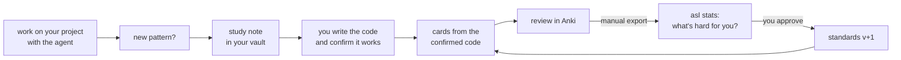

# agentic-studying-loop

Learn the code you write. While you work on a real project with an AI coding agent (Claude Code),
what you learn is turned into **study notes** in your notes vault and **Anki cards** that look like
your repo. Then the card rules are **tuned on your own review data**.



It comes from [rust-lang-kata](https://github.com/yungselm/rust-lang-kata), a Rust deck whose
card rules were re-derived from 6.5k of the author's own reviews (e.g. *typed characters, not
lines, predict failure*; *every leech was a code card that asked for a whole program*). This repo
makes that loop work for any project and any language.

## What's in the box

| | |
|---|---|
| **Card engine** (`asl`) | YAML → `.apkg`. Code cards with an in-card editor and line diff, concept cards, timeline cards (ordered steps, shuffled for you). Stable ids, so editing a card updates it in place. |
| **Packs** | Per language: syntax highlighting, a checker that compiles/lints/tests every card, a standards addendum. Ships with **Rust** (clippy + cargo test) and **Python** (ruff + pytest). |
| **Standards** | Data-backed rules for card size and shape (`standards/core.md`), copied into *your* vault where they evolve. |
| **Modes** | How much the agent teaches: `teacher`, `mentor`, `coworker`, `on-demand`. |
| **Skills** | `study-note`, `write-cards`, `check-cards`, `refresh-standards`: the procedures, loaded only when needed. Usable as a Claude Code plugin or copied into `.claude/skills`. |
| **Stats** | `asl stats` reads a manual Anki export and reports fail rates by card size, leeches, hard topics, and whether your last rule change helped. |
| **Examples** | `example-vault/` (notes, card home, a project deck) and `examples/tasklog/` (the project it belongs to). |

## Quickstart

```bash
git clone https://github.com/yungselm/agentic-studying-loop
cd agentic-studying-loop
pip install -e ".[python]"        # the `asl` command (+ ruff/pytest for the Python pack)

# connect a project: creates the card home in your vault, a deck folder, and a CLAUDE.md block
asl init ~/code/myproject --home "~/Vault/Studying/Anki cards" \
         --pack python --prefix myp --mode mentor --notes "~/Vault/Studying/MyProject"
```

Then give the agent the skills, either as a plugin:

```
/plugin marketplace add yungselm/agentic-studying-loop
/plugin install agentic-studying-loop@agentic-studying-loop
```

or as plain files: `asl install-skills` (copies them to `~/.claude/skills`).

Work as usual. When cards exist:

```bash
asl lint  "~/Vault/Studying/Anki cards/myproject"     # ids, size limits, self-contained?
asl check "~/Vault/Studying/Anki cards/myproject"     # compile / lint / run tests
asl build "~/Vault/Studying/Anki cards/myproject" -o myproject.apkg
```

Import into Anki with "Update notetypes" ticked. Try it on the bundled example first:
`asl build examples/python-core "example-vault/Studying/Anki cards/tasklog"`.

## Modes

`asl mode <name> <project>` switches; the block in `CLAUDE.md` is rewritten, your settings stay.

| mode | who writes code | notes | cards |
|---|---|---|---|
| `teacher` | **you**; the agent never edits source, explains with snippets | first, before the code | automatic, from confirmed code |
| `mentor` | you drive; the agent writes snippets/edits on request | offered for new topics | proposed at session end, you pick |
| `coworker` | the agent, as usual | on request | one-line "card-worthy" flags; cards on request |
| `on-demand` | the agent, as usual | on request | on request |

## Your card home (in your vault)

```
Studying/Anki cards/
├── studyloop.yaml        limits, refresh thresholds, standards_version
├── standards/
│   ├── core.md           copied from this repo, then yours
│   ├── python.md         pack addendum
│   └── preferences.md    your corrections, newest last (they win)
├── evidence/             reports from `asl stats`
└── myproject/
    ├── deck.yaml         deck name, pack, id prefix
    ├── myproject.yaml    checked cards (standard library + stubs)
    ├── myproject_ext.yaml  third-party code, verbatim, not compiled
    ├── profile.md        file roles for location headers
    └── Overview.md       card index
```

## Tuning the standards on your data

When *you* want to (nothing nags you): in Anki, File → Export → *Anki Deck Package* with
*Include scheduling information*, then ask the agent to *refresh my standards* (the
`refresh-standards` skill), or run it yourself:

```bash
asl stats export.apkg --home "~/Vault/Studying/Anki cards" --deck "Study Loop"
```

The report says whether a refresh is due (by default once 50% of the deck is mature, then every
further 25%), shows fail rates by typed size / answer length, leeches, hard decks, and compares
cards by the standards version they were written under. The agent proposes edits; you approve;
`standards_version` goes up.

## Docs

- [Card format](docs/card-format.md): YAML fields, card types, deck.yaml
- [Writing a pack](docs/writing-a-pack.md): add a language
- [Migrating from rust-lang-kata](docs/migrating-from-rust-lang-kata.md)
- [Roadmap](docs/roadmap.md): natural languages (subtitle sentence mining), more packs

## Status

v0.1, extracted from a personal setup. The Rust and Python packs and the stats report are tested;
the starter standards rest on one learner's data. Contributions of packs, card types, and
anonymised `asl stats` summaries are very welcome.

MIT licensed. CodeMirror 5 (MIT) is vendored for the in-card editor.
