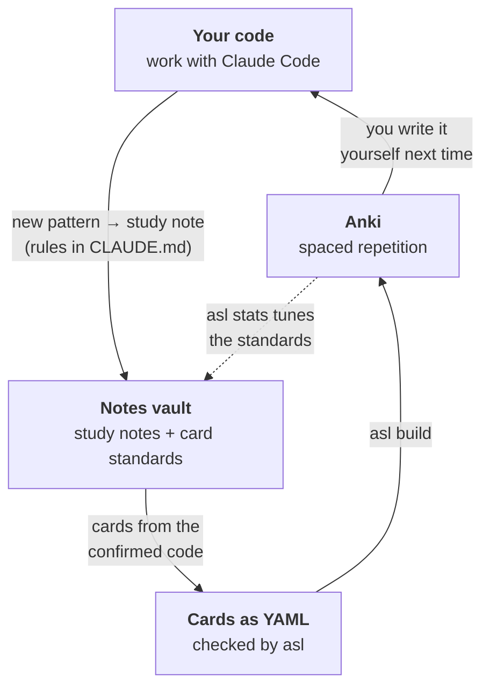

<p align="center">
  <a href="https://github.com/yungselm/agentic-studying-loop">
    
  </a>
</p>

# agentic-studying-loop

Counter brainrot, by forcing LLMs to maximizing your studying. Learn the code you write, while you work on a real project with an AI coding agent (Claude Code).
What you learn becomes **study notes** in your notes vault and **Anki cards** that look like your
repo. Then the card rules get **tuned on your own review data**.

## Pick your path

Since I want to make sure that this repository is usable by everybody, wanting to improve their studying I setup several paths in this repository ranging from technical to non-technical users.
Even though I tried to build something with this repository, that actually creates benefits from LLMs (see also readthedocs for my detailed thoughts), I respect if somebody doesn't want to use them at all. Therefore, I also included the possibility to use this repository just as anki card compilation engine.
Pick your path based on:

| You want… | Go to |
|---|---|
| Anki cards with a typing editor, written by hand in simple text files. No AI involved. | [Install](#install) → [Cards without an agent](#cards-without-an-agent) |
| The full loop: an AI agent turns what you learn in a project into notes and cards. | [Install](#install) → [The full loop](#the-full-loop) |
| The full loop, but you're not comfortable with the terminal: Claude sets it up for you. | [Let Claude set it up](#let-claude-set-it-up) |
| You're an AI agent asked to set this up. | [For agents](#for-agents) |

**What you need** (free, apart from a Claude plan for the agent paths and the optional iPhone app; click to download):

[](https://apps.ankiweb.net/)
[](https://obsidian.md/download)
[](https://claude.com/claude-code)
[](https://docs.astral.sh/uv/getting-started/installation/)

- **[Anki](https://apps.ankiweb.net/)**: the spaced-repetition app that shows you the cards.
  Free on desktop and Android (AnkiDroid); the iPhone app is paid. AnkiWeb syncs them.
- **[Obsidian](https://obsidian.md/download)** (optional): where your study notes and card files live.
  Any folder of text files works; Obsidian just makes the notes pleasant to read and link.
- **[Claude Code](https://claude.com/claude-code)** (agent paths only): the coding agent that writes
  notes and cards.
- **[uv](https://docs.astral.sh/uv/getting-started/installation/)**: installs the `asl` tool (see
  [Install](#install)). For Rust cards also a [Rust toolchain](https://rustup.rs/).



Grown out of [rust-lang-kata](https://github.com/yungselm/rust-lang-kata), whose card rules were
re-derived from 6.5k of my personal reviews (*typed characters, not lines, predict failure*;
*every leech was a code card asking for a whole program*).

## How it fits together

You don't clone this repo to use it. There are three places, and you set each up once:

| | What | Where it lives | Set up with |
|---|---|---|---|
| **1. The tool** | the `asl` command, language packs, default standards, modes, templates | installed like any CLI | `uv tool install …` |
| **2. The agent's skills** | `study-note`, `write-cards`, `check-cards`, `refresh-standards` | Claude Code | `/plugin install …` or `asl install-skills` |
| **3. Your data** | your standards, notes and cards | your notes vault (e.g. Obsidian), plus one block in each project's `CLAUDE.md` | `asl init` |

```
~/Vault/Studying/                     <- your notes vault (3)
├── test-rs/                         <- study notes for the project (the agent writes them)
└── Anki cards/                       <- the "card home"
    ├── studyloop.yaml                   limits, refresh thresholds, standards version
    ├── standards/                       core.md, rust.md, preferences.md: YOUR rules, they evolve
    ├── evidence/                        reports from `asl stats`
    └── test_rs/                        one deck folder per project
        ├── deck.yaml                    deck name, pack, id prefix, repo path
        ├── test_rs.yaml                cards checked by `asl check` (std + stubs)
        ├── test_rs_ext.yaml            cards with third-party code (verbatim, not compiled)
        ├── profile.md                   file roles for the cards' location headers
        └── Overview.md                  card index

~/code/test-rs/                      <- your project: unchanged, except
└── CLAUDE.md                            a study-loop block (mode + the paths above)
```

## Install

```bash
# 1. uv (skip if installed); then open a new terminal
curl -LsSf https://astral.sh/uv/install.sh | sh                                    # macOS / Linux / WSL
powershell -ExecutionPolicy ByPass -c "irm https://astral.sh/uv/install.ps1 | iex"  # Windows

# 2. asl
uv tool install "agentic-studying-loop @ https://github.com/yungselm/agentic-studying-loop/archive/refs/heads/main.zip"
asl packs                     # lists python, rust; if `asl` isn't found: uv tool update-shell

# update later
uv tool install --force "agentic-studying-loop @ https://github.com/yungselm/agentic-studying-loop/archive/refs/heads/main.zip"
```

Rust cards also need [Rust](https://rustup.rs/) with `rustup component add clippy`.

## Cards without an agent

`asl` works fine on its own: you write cards in simple text files, it checks them and builds an Anki
deck with an in-card code editor (on flip, lines that differ from the solution turn red).

1. **Make a folder for your cards**, e.g. `my-cards`, with a file `deck.yaml`:

   ```yaml
   deck: "My Cards::Python"   # the deck name in Anki
   pack: python               # or rust
   prefix: py                 # card ids become py-001, py-002, ...
   ```

2. **Write cards** in another file in that folder, e.g. `basics.yaml` (each file becomes a subdeck):

   ```yaml
   - instruction: |
       Return the list with every number doubled, using a list comprehension.
     starter: |
       def double_all(nums: list[int]) -> list[int]:

     solution: |
       def double_all(nums: list[int]) -> list[int]:
           return [n * 2 for n in nums]
     tests: |
       assert double_all([1, 2]) == [2, 4]

   - type: concept
     question: What does `enumerate(xs)` yield?
     answer: |
       **Pairs `(index, item)`, starting at index 0.** Pass `start=1` to count from 1.
   ```

   The two spaces of indentation matter. More card types and fields: [card format](docs/card-format.md);
   the rules for cards that stick: [standards](studyloop/standards/core.md).

3. **Check and build** (in the terminal, in the folder that contains `my-cards`):

   ```bash
   asl fix my-cards                          # gives every card a stable id (run after adding cards)
   asl check my-cards                        # optional: runs your solutions and tests
   asl build my-cards -o my-cards.apkg
   ```

4. **Import** `my-cards.apkg` in Anki (File → Import, tick **Update notetypes**). After editing
   cards, repeat steps 3 and 4: changed cards update in place, your review history stays.

## The full loop

**1. Give Claude Code the skills.** In Claude Code, install the plugin:

```
/plugin marketplace add yungselm/agentic-studying-loop
/plugin install agentic-studying-loop@agentic-studying-loop
```

or copy the skills into `~/.claude/skills` with `asl install-skills`.

**2. Connect a project:**

```bash
asl init ~/code/test-rs \
    --home  "~/Vault/Studying/Anki cards" \
    --notes "~/Vault/Studying/test-rs" \
    --pack rust --prefix tst --mode mentor
```

Replace the paths with your own: your project folder, a folder in your notes vault for the cards
(the "card home"), and a folder for study notes. Pick a short id prefix and a [mode](#modes). On
Windows, put the command on one line and use `C:\...` paths. This creates the card home (only the first time), the deck folder, and the study-loop block in the project's `CLAUDE.md`.

**3. Day to day:** work in the project with Claude Code as usual. Depending on the mode, the agent writes study notes and cards into your vault and verifies them with `asl`. You build and import:

```bash
asl build "~/Vault/Studying/Anki cards/test_rs" -o test-rs.apkg
```

In Anki: File → Import, tick **Update notetypes**. Tick **Import any deck presets** only on the first import (it sets new-cards-per-day; later it would reset settings you changed). Changed cards update in
place; nothing to delete by hand.

The commands the agent runs (you can run them too):

| | |
|---|---|
| `asl fix <deck>` | add missing ids, standards version, `Overview.md` rows |
| `asl lint -q <deck>` | sizes, self-containment, context frame, headers, verbatim excerpts, drift |
| `asl check <deck>` | compile / lint / run every card's tests (clippy + cargo test, ruff + pytest) |
| `asl mode <mode> <project>` | switch the mode in the project's `CLAUDE.md` |

## Let Claude set it up

You need Anki and Claude Code installed (links [above](#pick-your-path)). Open Claude Code in your project folder and paste:

> Set up agentic-studying-loop for this project, following the "For agents" section of
> https://github.com/yungselm/agentic-studying-loop. Explain each step before you run it.

Claude installs the tool, asks you where your notes should live and how much it should teach you, connects the project, and tells you how to get the cards into Anki.

## For agents

Steps for an AI agent setting this up for a user. Explain each step briefly; ask before changing
anything outside the project and the chosen notes folder.

1. **Prerequisites:** check `uv --version` (else install uv with the official command from the
   [Install](#install) table for the user's OS, then use the full path or a new shell). For Rust
   projects check `cargo clippy --version`. Check that Anki is installed; if not, give the user the
   link and wait.
2. **Install:** `uv tool install "agentic-studying-loop @ https://github.com/yungselm/agentic-studying-loop/archive/refs/heads/main.zip"`, then `asl packs`.
3. **Ask the user** (one question at a time): where the notes vault is (an Obsidian vault or any
   folder; suggest one inside their documents), and which mode: `teacher` (user writes all code),
   `mentor`, `coworker`, `on-demand` (see Modes). Use a 2–4 letter id prefix derived from the project
   name; the pack follows the project's language (`rust` or `python`).
4. **Connect:** `asl init <project> --home "<vault>/Anki cards" --notes "<vault>/<project>"
   --pack <pack> --prefix <prefix> --mode <mode>`. Use real absolute paths, never placeholders.
5. **Skills:** `asl install-skills` (or the plugin commands above if the user prefers).
6. **Verify:** `asl lint -q "<vault>/Anki cards/<deck>"` prints `OK`.
7. **Tell the user** in plain words: where notes and cards will appear, that cards are built with
   `asl build "<deck folder>" -o <name>.apkg` and imported in Anki via File → Import (tick "Update
   notetypes"), and that the agent follows the chosen mode from now on.

## Modes

| mode | code | notes | cards |
|---|---|---|---|
| `teacher` | **you**; the agent never edits source | first, before the code | automatic, from confirmed code |
| `mentor` | you drive; the agent helps on request | offered | proposed at session end |
| `coworker` | the agent | on request | one-line "card-worthy" flags; on request |
| `on-demand` | the agent | on request | on request |

## Tuning the standards on your data

Whenever you like: in Anki, File → Export → *Anki Deck Package* with *Include
scheduling information*, then ask the agent to *refresh my standards*, or run
`asl stats export.apkg --home "<card home>"`. The report says whether a refresh is due (default:
half the deck mature, then every further 25%), and shows fail rates by card size, leeches, hard
decks, and whether the last rule change helped. The agent proposes edits to your standards; you
approve them.

## Examples

This repo contains a complete worked example to browse: `examples/tasklog/` (a small project and
its `CLAUDE.md`) and `example-vault/` (its notes, card home and deck). With a clone you can build
it: `asl build examples/python-core "example-vault/Studying/Anki cards/tasklog"`.

## Contributing

Clone the repo and install it editable:

```bash
git clone https://github.com/yungselm/agentic-studying-loop && cd agentic-studying-loop
uv venv && uv pip install -e ".[dev]"
```

Everything the tool ships lives in `studyloop/`: `packs/` (one folder per language), `standards/`,
`modes/`, `templates/`, `anki/` (note-type templates). `skills/` and `.claude-plugin/` stay at the
root, where Claude Code expects a plugin. See [CONTRIBUTING.md](CONTRIBUTING.md).

## Docs

[Card format](docs/card-format.md) · [Writing a pack](docs/writing-a-pack.md) (also possible
without cloning) · [Migrating from rust-lang-kata](docs/migrating-from-rust-lang-kata.md) ·
[Roadmap](docs/roadmap.md)

v0.1. The starter standards rest on one learner's data. Packs, card types and anonymised
`asl stats` tables are welcome. MIT license; vendors CodeMirror 5 (MIT).

## Words of Encouragement ⸜(｡˃ ᵕ ˂ )⸝♡
The rest is up to you! Remember Anki only works if you do it everyday. Let's tackle outsourcing thinking and brainrot together. 
Don't expect the results to be perfect, LLMs as always tend to be bloated. But compared to previous workflows these still save
me countless hours, by just deleting cards I don't like and revising the other while reviewing.

