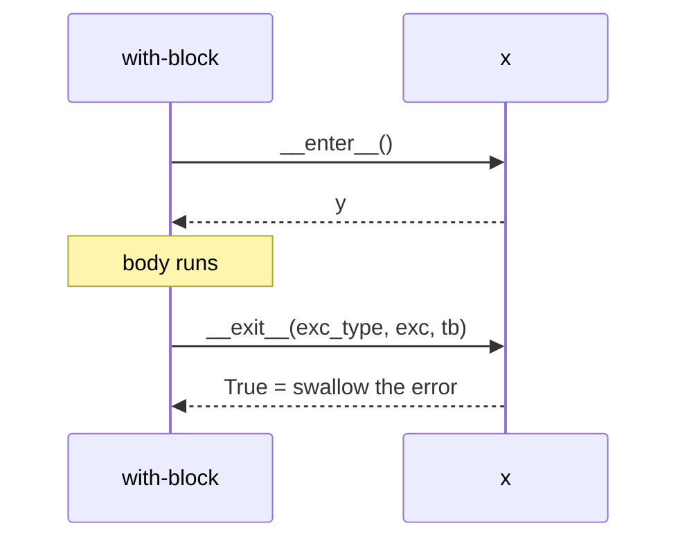

# Context managers

> [!tldr]
> `with x as y:` runs **`__enter__`**, then the body, then **`__exit__`**, even when the body raised. Cleanup you can't forget: a reusable [[try - finally]].



## Why care
Every `open()` without `with` is a file left open when an exception jumps past `close()`. On Windows that file then can't be renamed or deleted.

## How it works
1. Evaluate `x` (e.g. `open(p)` creates the file object).
2. `y = x.__enter__()`.
3. Run the body.
4. `x.__exit__(exc_type, exc, tb)`; all three are `None` if nothing was raised.

> [!example] Your own, with a generator
> ```python
> from contextlib import contextmanager
>
> @contextmanager
> def opened(p):
>     f = open(p)
>     try:
>         yield f          # the with-body runs here
>     finally:
>         f.close()
> ```

> [!warning] Pitfalls
> - `__exit__` returning a truthy value **hides the exception**. File objects return `False`.
> - With `@contextmanager`, forgetting `try/finally` around `yield` skips cleanup on errors.

> [!question]- Test yourself: the body raises `KeyError`. What runs, in which order?
> `__exit__(KeyError, err, tb)` runs; if it returns `False`/`None`, the `KeyError` continues upwards after the cleanup.

## Connections
- builds on: [[try - finally]]: `with` is try/finally packaged as an object
- used by: [[Atomic file writes]]: `os.fdopen` closes the temp file
