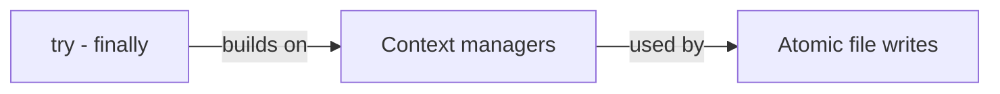

# Python (general): study notes

> [!tldr]
> Python ideas that came up across projects. Start top left on the map.

## Reading order
1. [[try - finally]]: cleanup that runs on every exit path
2. [[Context managers]]: what `with` calls, in which order, and when errors are swallowed
