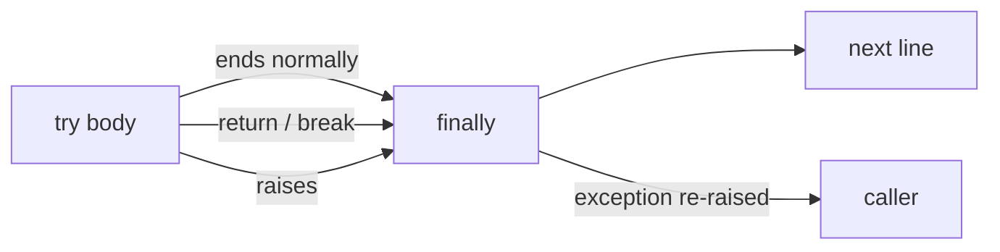

# try - finally

> [!tldr]
> Code in **`finally`** runs on every way out of the `try`: normal end, `return`, `break`, or an exception. The exception keeps going afterwards.

## Why care
A lock that is never released freezes the program the second time. Cleanup belongs where no exit path can skip it.

## How it works
1. Run the `try` body.
2. Whatever ends it, run `finally`.
3. Then continue the way the body ended: return the value, or re-raise the exception.

> [!warning] Pitfalls
> - A `return` inside `finally` **replaces** the pending exception or return value.
> - `finally` is for cleanup, not handling: to handle an error, use `except`.

> [!question]- Test yourself: `try: return 1` / `finally: print("x")`. What happens?
> Prints `x`, then the function returns `1`.

## Connections
- used by: [[Context managers]]: `with` packages this into an object
- see also: [[Atomic file writes]]: delete the temp file if writing fails
