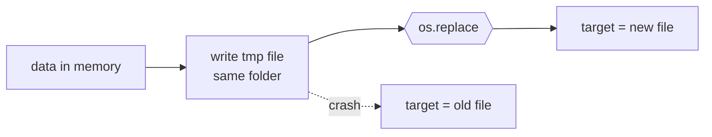

# Atomic file writes

> [!tldr]
> Write a **temp file** next to the target, then swap it in with one **`os.replace`**. Readers and crashes see the old file or the new one, never half of each.

## Why care
The program dies halfway through `write()`: the task list is now half a JSON file, and the next `load()` crashes. With an atomic write the worst case is losing the last change.

## How it works
1. Build the full content in memory (`json.dumps`).
2. `tempfile.mkstemp(dir=target.parent)` makes a unique file on the **same file system**.
3. Write it, close it.
4. `os.replace(tmp, target)`: a rename, atomic within one file system.

## In this project
`Store.save()` in `src/tasklog/store.py` does exactly these four steps.

> [!warning] Pitfalls
> - A temp file in `/tmp` can be on another file system: then the rename isn't atomic.
> - `os.rename` won't overwrite on Windows; `os.replace` overwrites everywhere.
> - After a crash a stray `*.tmp` can stay behind: harmless, clean it up on start if needed.

> [!question]- Test yourself: why `dir=target.parent` and not the default temp folder?
> A rename is only atomic **within one file system**; `/tmp` may be a different one.

## Connections
- builds on: [[Context managers]]: `os.fdopen(...)` closes the temp file
- see also: [[try - finally]]: delete the temp file if writing fails
- see also: [[fsync and durability]]: atomic is not the same as on disk
