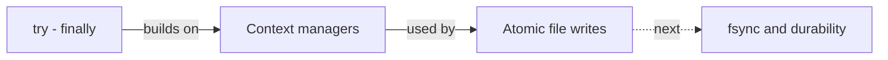

# Tasklog: study notes

> [!tldr]
> What building tasklog taught: saving data safely. Cards: `Anki cards/tasklog/Overview.md`.

## Reading order
1. [[Context managers]] (Python general): `with` closes the temp file
2. [[Atomic file writes]]: temp file + `os.replace`, why the temp file sits next to the target

## Next
- [[fsync and durability]]: when is the data really on disk?
